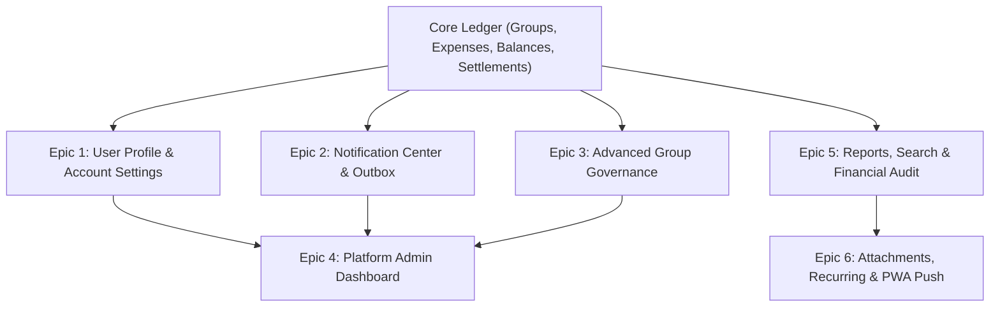

# Hisabo — Engineering Task Roadmap & Technical Specification

> **Document Version:** 2.0.0  
> **Target Branch:** `Devbranch`  
> **Source Base:** `review2.md` (Consolidated & Structured)  
> **Platform Stack:** Next.js 16 (App Router), React 19, TypeScript 5 (Strict), Tailwind CSS v4, Neon PostgreSQL, Drizzle ORM, Auth.js v5

---

## 1. Executive Summary & Architecture Context

Hisabo's core shared-expense loop is already operational:
- **Groups:** Group creation, membership association, cryptographic tokenized invite links.
- **Expenses:** Integer minor-unit halala math, deterministic remainder distribution, multi-participant splitting.
- **Balances:** Zero-sum balance ledger, dynamic derivation, multi-currency segregated balances.
- **Settlements:** Off-platform payment claims, Pending Actions Center on the dashboard, creditor confirmation & dispute workflow.
- **Desktop & Mobile UI:** Notion-inspired sharp borders, responsive full-width desktop layout with collapsible sidebar toggle, and preserved mobile navigation.

This roadmap organizes the remaining features outlined in `review2.md` into **6 Epics and 30 Actionable Engineering Tasks**. Each task contains concrete technical requirements, affected database tables, file paths, and verifiable acceptance criteria.



---

## 2. Implementation Progress Overview

| Epic | Focus Area | Status | Priority |
| :--- | :--- | :---: | :---: |
| **Epic 1** | User Profile, Preferences & Account Management | Completed | `P0` |
| **Epic 2** | Notification Center & Transactional Outbox Worker | Completed | `P0` |
| **Epic 3** | Advanced Group Governance & Closure Lifecycles | Completed | `P1` |
| **Epic 4** | Platform Admin Portal & Moderation Queue | Completed | `P1` |
| **Epic 5** | Financial Search, Reporting & CSV Data Exports | Completed | `P1` |
| **Epic 6** | Growth: Receipts S3 Storage, Recurring Expenses & Push | In Progress (5 Shipped) | `P2` |

---

## Epic 1: User Profile, Preferences & Account Management

### TASK-01: User Profile Details & Avatar Upload
- **Priority:** `P0 - Launch Blocker`
- **Files Affected:**  
  - [`src/app/(user-panel)/settings/page.tsx`](file:///c:/orant/BROWSE60/DEMO/jdk/bin/PerfLogss/doc/cla/corporate/debian/Setup/important/hisabo/src/app/(user-panel)/settings/page.tsx)  
  - [`src/features/settings/actions.ts`](file:///c:/orant/BROWSE60/DEMO/jdk/bin/PerfLogss/doc/cla/corporate/debian/Setup/important/hisabo/src/features/settings/actions.ts)  
  - `src/app/(backend)/_lib/db/schema/auth.ts`
- **Requirements:**
  - Add optional `avatar_url` column to `users` table.
  - Allow users to update Display Name and Username with unique conflict validation.
  - Support image upload or initial-based SVG fallback selection.
- **Acceptance Criteria:**
  - [ ] Username availability checked in real-time or via action validation.
  - [ ] Invalid username characters rejected (must match `^[a-zA-Z0-9_]{3,30}$`).
  - [ ] UI reflects updated profile information across sidebar and headers immediately without page reload.

---

### TASK-02: App Preferences (Default Currency & Locale Display)
- **Priority:** `P0 - Launch Blocker`
- **Files Affected:**  
  - `src/app/(backend)/_lib/db/schema/auth.ts`  
  - `src/features/settings/schema.ts`  
  - [`src/app/(user-panel)/settings/settings-client.tsx`](file:///c:/orant/BROWSE60/DEMO/jdk/bin/PerfLogss/doc/cla/corporate/debian/Setup/important/hisabo/src/app/(user-panel)/settings/settings-client.tsx)
- **Requirements:**
  - Add `default_currency` (SAR, AED, USD, EUR, etc.), `timezone`, and `theme` preferences to `users` table.
  - **Financial Safety Rule:** Display preference only. Never automatically convert or merge distinct currencies in balances or ledger rows.
- **Acceptance Criteria:**
  - [ ] Saving preferred currency pre-selects that currency in "+ Add Expense" and "+ Record Settlement" forms.
  - [ ] Ledger and Balances views continue strict currency segregation.

---

### TASK-03: Security & Active Sessions Management
- **Priority:** `P1 - High Priority`
- **Files Affected:**  
  - `src/app/(backend)/_lib/db/schema/auth.ts`  
  - `src/features/auth/`  
  - [`src/app/(user-panel)/settings/page.tsx`](file:///c:/orant/BROWSE60/DEMO/jdk/bin/PerfLogss/doc/cla/corporate/debian/Setup/important/hisabo/src/app/(user-panel)/settings/page.tsx)
- **Requirements:**
  - Track active sessions in `sessions` table (`user_id`, `session_token`, `ip_address`, `user_agent`, `last_active_at`).
  - Allow user to view current session device and list of other active sessions.
  - Provide "Revoke Other Sessions" button.
- **Acceptance Criteria:**
  - [ ] Terminating a session marks the session record invalid and rejects subsequent cookie validations.
  - [ ] Current device session remains active when "Sign out all other devices" is executed.

---

### TASK-04: Password Change & Credential Verification
- **Priority:** `P0 - Launch Blocker`
- **Files Affected:**  
  - [`src/features/settings/actions.ts`](file:///c:/orant/BROWSE60/DEMO/jdk/bin/PerfLogss/doc/cla/corporate/debian/Setup/important/hisabo/src/features/settings/actions.ts)  
  - `src/features/auth/password.ts`
- **Requirements:**
  - Require `currentPassword`, `newPassword`, and `confirmPassword`.
  - Validate password strength: minimum 8 characters, at least 1 number and 1 special character.
  - Verify current password using Argon2id/bcrypt before updating hash.
- **Acceptance Criteria:**
  - [ ] Incorrect current password returns user-friendly error with rate limiting.
  - [ ] Password updated securely in single transaction; toast notification confirms success.

---

### TASK-05: Account Deletion & Financial Data Safeguard Workflow
- **Priority:** `P1 - High Priority`
- **Files Affected:**  
  - `src/features/settings/actions.ts`  
  - `src/app/(backend)/_lib/services/user/`
- **Requirements:**
  - Allow users to request account deletion.
  - **Financial Data Integrity Rule:** Never hard-delete financial rows where other group members depend on historical expense records.
  - Anonymize user profile (`deleted_user_<id>`, remove email and phone) and mark `status = 'deleted'`.
  - Block deletion if user has outstanding unsettled debts (`net_balance < 0`) in any active group.
- **Acceptance Criteria:**
  - [ ] Prompts warning modal listing groups where user has active balances.
  - [ ] Blocks deletion if user owes money until all balances are settled to zero.
  - [ ] Successfully clears sessions, invalidates auth tokens, and redirects to public landing page.

---

## Epic 2: Multi-Channel Notification Center & Transactional Outbox

### TASK-06: Database Notification Entity & In-App Feed
- **Priority:** `P0 - Launch Blocker`
- **Files Affected:**  
  - `src/app/(backend)/_lib/db/schema/notifications.ts`  
  - `src/features/notifications/queries.ts`  
  - `src/features/notifications/components/`  
  - `src/app/(user-panel)/notifications/page.tsx`
- **Requirements:**
  - Schema: `id`, `user_id`, `actor_id`, `type`, `title`, `body`, `entity_type`, `entity_id`, `is_read`, `created_at`.
  - Types: `expense_created`, `expense_split_assigned`, `settlement_claimed`, `settlement_confirmed`, `settlement_disputed`, `group_invite`.
  - In-app notification page with "Unread" / "All" tabs, "Mark All as Read", and pagination.
- **Acceptance Criteria:**
  - [ ] Notification bells in navbar and sidebar update unread count dynamically.
  - [ ] Clicking a notification navigates directly to the target expense (`/expenses/[id]`) or settlement (`/settlements`).

---

### TASK-07: Notification Delivery Preferences
- **Priority:** `P1 - High Priority`
- **Files Affected:**  
  - `src/app/(backend)/_lib/db/schema/notifications.ts`  
  - `src/features/settings/`
- **Requirements:**
  - Per-user toggles for event types:
    - New expense involving user (In-app, Email)
    - Settlement claimed / confirmed (In-app, Email)
    - Dispute raised / resolved (In-app, Email)
    - Group invitations (In-app, Email)
    - Weekly spending digests (Email)
- **Acceptance Criteria:**
  - [ ] Settings page renders interactive notification preference matrix.
  - [ ] Outbox processor checks user preferences before queueing outgoing emails.

---

### TASK-08: Transactional Outbox Engine & Worker
- **Priority:** `P0 - Launch Blocker`
- **Files Affected:**  
  - `src/app/(backend)/_lib/db/schema/outbox.ts`  
  - `src/app/(backend)/_lib/services/outbox/`
- **Requirements:**
  - All domain events (e.g. `expense.created`, `settlement.claimed`) written to `outbox_events` in the **same ACID transaction** as business data.
  - Background worker / route handler (`/api/cron/outbox`) processes events with exponential backoff (`attempts`, `max_attempts: 5`, `next_retry_at`).
  - Idempotency key tracking to guarantee at-least-once delivery with exactly-once execution.
- **Acceptance Criteria:**
  - [ ] Failed external email API calls do not roll back expense creation.
  - [ ] Outbox entries retry automatically on temporary network failures.

---

### TASK-09: Transactional Email Templates (Resend / SMTP)
- **Priority:** `P1 - High Priority`
- **Files Affected:**  
  - `src/app/(backend)/_lib/services/email/`  
  - `src/components/emails/`
- **Requirements:**
  - Implement responsive email templates with Hisabo branding (`#185CFF`, Notion-clean typography):
    1. Welcome & Email Verification Code
    2. Password Reset Link
    3. Group Invitation Link
    4. Settlement Awaiting Confirmation Alert
- **Acceptance Criteria:**
  - [ ] Emails display clearly on both mobile and desktop mail clients.
  - [ ] Plain-text fallback generated automatically for all emails.

---

### TASK-10: Web Push (VAPID) & Service Worker Integration
- **Priority:** `P2 - Enhancement`
- **Files Affected:**  
  - `public/sw.js`  
  - `src/app/(backend)/_lib/db/schema/notifications.ts` (`push_subscriptions` table)  
  - `src/app/(backend)/_lib/services/push/`
- **Requirements:**
  - Subscribe user browser/PWA to Web Push via VAPID keys.
  - Handle background push in service worker.
  - **Privacy Rule:** Never show sensitive monetary amounts or private item descriptions on public lock-screen notifications by default.
- **Acceptance Criteria:**
  - [x] User can grant push permission from Settings or Notification center.
  - [x] Unsubscribing removes endpoint from `push_subscriptions` table.

---

## Epic 3: Advanced Group Governance & Lifecycle

### TASK-11: Group Role-Based Access Control (RBAC)
- **Priority:** `P0 - Launch Blocker`
- **Files Affected:**  
  - `src/app/(backend)/_lib/db/schema/groups.ts` (`role: 'owner' | 'admin' | 'member'`)  
  - `src/features/groups/`
- **Requirements:**
  - **Owner:** Full control (archive group, delete empty group, transfer ownership, manage roles).
  - **Admin:** Edit group metadata, manage invite links, remove members with zero balance.
  - **Member:** Create expenses, record settlements, view ledger.
- **Acceptance Criteria:**
  - [ ] Non-admins attempting to change group settings receive `403 Forbidden`.
  - [ ] Group member list displays role badges (`Owner`, `Admin`, `Member`).

---

### TASK-12: Member Removal & Voluntary Departure Safeguards
- **Priority:** `P0 - Launch Blocker`
- **Files Affected:**  
  - `src/features/groups/actions.ts`  
  - `src/features/balances/queries.ts`
- **Requirements:**
  - Check user net balance in group before allowing removal or departure.
  - If `netBalance !== 0`, block action with detailed message:
    - Negative balance: "You must settle your outstanding debt of SAR XX.XX before leaving."
    - Positive balance: "You are owed SAR XX.XX. Collect settlements or forfeit before leaving."
  - Deactivating a member retains their historical expenses in the ledger.
- **Acceptance Criteria:**
  - [ ] Zero balance allows clean departure; membership status set to `inactive`.
  - [ ] Historical splits and receipts remain intact for remaining members.

---

### TASK-13: Group Archival & Flat Move-Out Closure Workflow
- **Priority:** `P1 - High Priority`
- **Files Affected:**  
  - `src/app/(backend)/_lib/db/schema/groups.ts` (`status: 'active' | 'archived'`)  
  - `src/features/groups/`
- **Requirements:**
  - Dedicated "Group Closure" mode for roommates moving out:
    1. Locks group from new expenses.
    2. Displays final balance settlement matrix.
    3. Allows members to record final offline settlements.
    4. Once all member net balances reach zero, owner can click "Archive Group".
- **Acceptance Criteria:**
  - [ ] Archived groups are read-only.
  - [ ] Archived groups appear in separate "Archived" section in Group list.

---

### TASK-14: Group Audit History & Activity Log
- **Priority:** `P1 - High Priority`
- **Files Affected:**  
  - `src/app/(backend)/_lib/db/schema/groups.ts`  
  - `src/app/(user-panel)/groups/[id]/activity/page.tsx`
- **Requirements:**
  - Log group events: member joined, member removed, role updated, group name edited, expense deleted/disputed, invite link regenerated.
  - Chronological activity feed accessible to all group members.
- **Acceptance Criteria:**
  - [ ] Activity entries timestamped with actor name and action description.
  - [ ] Pagination supported for active groups with high activity.

---

### TASK-15: Ownership Transfer Workflow
- **Priority:** `P2 - Enhancement`
- **Files Affected:**  
  - `src/features/groups/actions.ts`  
  - `src/app/(user-panel)/groups/[id]/settings/`
- **Requirements:**
  - Group Owner can designate an active Admin or Member as the new Owner.
  - Two-step confirmation dialog with password re-entry.
  - Original owner transitions to `admin` role.
- **Acceptance Criteria:**
  - [x] Database transaction updates both membership roles atomically.
  - [x] Notification sent to the designated new owner.

---

## Epic 4: Platform Admin Portal & Moderation Queue

### TASK-16: Admin Authentication & Role Protection
- **Priority:** `P0 - Launch Blocker`
- **Files Affected:**  
  - `src/app/(backend)/_lib/auth/guards.ts`  
  - `src/app/(admin-panel)/admin/`
- **Requirements:**
  - Separate `role = 'admin'` requirement on `/admin/*` routes.
  - Redirect unauthorized users with `403 Access Denied`.
  - Enforce re-authentication or short session expiry for admin panel.
- **Acceptance Criteria:**
  - [ ] Regular users cannot access `/admin` under any circumstances.
  - [ ] All admin actions logged to `admin_audit_logs` table.

---

### TASK-17: Platform Overview & System Health Metrics
- **Priority:** `P1 - High Priority`
- **Files Affected:**  
  - `src/app/(admin-panel)/admin/page.tsx`  
  - `src/features/admin/queries.ts`
- **Requirements:**
  - Key metrics cards:
    - Total Users (Active, Suspended, New this week)
    - Total Groups (Active vs Archived)
    - Total Expenses recorded (Volume & Total Minor Units per currency)
    - Settlement claim ratio (Pending vs Confirmed vs Disputed)
    - Outbox health (Pending jobs, failed retries)
- **Acceptance Criteria:**
  - [ ] Metrics load via efficient aggregate queries without full table scans.
  - [ ] Outbox failure alert highlighted in red if retry queue exceeds threshold.

---

### TASK-18: Admin User Management & Account Moderation
- **Priority:** `P1 - High Priority`
- **Files Affected:**  
  - `src/app/(admin-panel)/admin/users/`  
  - `src/features/admin/actions.ts`
- **Requirements:**
  - Search users by name, username, or email.
  - View account status, registration date, active group count.
  - Actions: Suspend Account, Reactivate Account, Trigger Password Reset, Force Logout.
  - **Privacy Safeguard:** Admin cannot view private plaintext expense descriptions or notes without explicit support escalation flag.
- **Acceptance Criteria:**
  - [ ] Suspended users receive immediate session revocation and cannot sign in.
  - [ ] Reason for suspension required and logged in audit history.

---

### TASK-19: Group Health & Abuse Reports Queue
- **Priority:** `P1 - High Priority`
- **Files Affected:**  
  - `src/app/(admin-panel)/admin/groups/`  
  - `src/app/(admin-panel)/admin/disputes/`
- **Requirements:**
  - View aggregate group metadata (member count, expense count, creation date).
  - Moderation queue for reported abusive groups or user disputes.
  - Admin ability to freeze a group under investigation.
- **Acceptance Criteria:**
  - [ ] Freezing group prevents any new expenses or settlements while preserving all existing data.

---

### TASK-20: Admin Privileged Audit Log Viewer
- **Priority:** `P1 - High Priority`
- **Files Affected:**  
  - `src/app/(admin-panel)/admin/audit-logs/page.tsx`  
  - `src/app/(backend)/_lib/db/schema/outbox.ts` (`admin_audit_logs` table)
- **Requirements:**
  - Tamper-evident log of all admin operations:
    - Admin ID, Target Entity, Action, Metadata payload, IP address, Timestamp.
  - Filter by date range, admin user, or action type.
- **Acceptance Criteria:**
  - [ ] Audit logs are strictly append-only; no deletion or modification allowed.

---

## Epic 5: Financial Operations, Reporting & Security Audit

### TASK-21: Expense Search & Multi-Criteria Filter Engine
- **Priority:** `P1 - High Priority`
- **Files Affected:**  
  - `src/features/expenses/queries.ts`  
  - `src/app/(user-panel)/expenses/page.tsx`
- **Requirements:**
  - Filter expenses by:
    - Category (Food, Rent, Utilities, Transport, Groceries, Entertainment, General)
    - Payer (Paid by me vs Paid by others)
    - Group association
    - Date range (This month, Last month, Custom range)
    - Minimum / Maximum amount
- **Acceptance Criteria:**
  - [ ] Fast search query with debounce and URL search params persistence.
  - [ ] Preserves integer minor-unit amount filtering.

---

### TASK-22: Partial Settlements & Installment Tracking
- **Priority:** `P1 - High Priority`
- **Files Affected:**  
  - `src/features/settlements/`  
  - `src/app/(backend)/_lib/services/settlement/`
- **Requirements:**
  - Allow debtor to record partial settlement (e.g. paying SAR 40 of an outstanding SAR 100 balance).
  - Balance updates dynamically upon payee confirmation: remaining debt decreases to SAR 60.
  - Full audit trail showing settlement installments tied to the peer balance.
- **Acceptance Criteria:**
  - [ ] Partial amount must satisfy: `0 < amountMinor <= outstandingDebtMinor`.
  - [ ] Zero-loss invariant verified across all balance ledger calculations.

---

### TASK-23: Expense Edit Audit Trail & Modification History
- **Priority:** `P1 - High Priority`
- **Files Affected:**  
  - `src/app/(backend)/_lib/db/schema/expenses.ts` (`expense_events` table)  
  - `src/features/expenses/`
- **Requirements:**
  - When an expense is edited (amount, participants, description):
    1. Log previous values into `expense_events` table.
    2. Notify affected participants that expense was updated.
    3. Re-calculate participant debits and payer credits atomically.
- **Acceptance Criteria:**
  - [ ] Expense detail page shows "Edit history" modal with diff of old vs new values.
  - [ ] Invariant $\sum \text{splits} = \text{total}$ strictly validated before saving edit.

---

### TASK-24: Financial Reports & CSV Data Export
- **Priority:** `P1 - High Priority`
- **Files Affected:**  
  - `src/app/(user-panel)/reports/`  
  - `src/app/(user-panel)/api/export/route.ts`
- **Requirements:**
  - Monthly spending summary with category breakdown charts.
  - Export expenses and settlements to RFC 4180 compliant CSV format.
  - Include columns: Date, Group, Description, Category, Paid By, Total Amount, Your Share, Currency.
- **Acceptance Criteria:**
  - [ ] Exports stream directly to client as attachment (`content-disposition: attachment`).
  - [ ] Numbers formatted cleanly with two decimal places from minor units.

---

### TASK-25: Automated Financial Consistency Unit & Invariant Tests
- **Priority:** `P0 - Launch Blocker`
- **Files Affected:**  
  - `tests/money.test.ts`  
  - `tests/ledger-invariants.test.ts`
- **Requirements:**
  - Comprehensive unit test suite verifying:
    1. Odd remainder halala splits (100.00 SAR split 3 ways $\rightarrow$ 33.34 + 33.33 + 33.33).
    2. Zero-sum ledger conservation: $\sum \text{all member positions} = 0$.
    3. Multi-currency segregation: EUR and SAR balances never mixed.
    4. Settlement debt clearance: Confirmed settlement clears peer debt exactly.
- **Acceptance Criteria:**
  - [ ] All financial unit tests pass with 100% test coverage on money math.

---

## Epic 6: Growth & Advanced Experience Modules

### TASK-26: Private Receipt Upload & Pre-Signed S3 Storage
- **Priority:** `P2 - Enhancement`
- **Files Affected:**  
  - `src/app/(backend)/_lib/services/storage/`  
  - `src/features/expenses/components/receipt-uploader.tsx`
- **Requirements:**
  - Direct client-to-bucket upload via short-lived pre-signed S3/R2 URLs.
  - Store receipts in private bucket (no public read permissions).
  - Generate 15-minute expiring download URLs only for verified group members.
- **Acceptance Criteria:**
  - [ ] Non-group members cannot access or guess receipt image URLs.
  - [ ] Supports PNG, JPEG, and WebP up to 5MB.

---

### TASK-27: Recurring Expenses Engine (Rent & Subscriptions)
- **Priority:** `P2 - Enhancement`
- **Files Affected:**  
  - `src/app/(backend)/_lib/db/schema/expenses.ts` (`recurring_expenses` table)  
  - `src/app/(backend)/_lib/services/cron/recurring-expenses.ts`
- **Requirements:**
  - Support monthly, weekly, or bi-weekly recurring expense templates (e.g. Apartment Rent on 1st of month).
  - Background cron triggers expense generation on schedule.
  - Sends review notification to participants before committing or creates active expense automatically based on group preference.
- **Acceptance Criteria:**
  - [ ] Next run date calculated correctly across month boundaries and leap years.
  - [ ] User can pause, resume, or cancel recurring schedule.

---

### TASK-28: Peer Payment Deep Linking (STC Pay & Bank Transfer Helpers)
- **Priority:** `P2 - Enhancement`
- **Files Affected:**  
  - `src/features/settlements/components/settle-modal.tsx`  
  - `src/features/settings/`
- **Requirements:**
  - Allow users to store their preferred payment handle in profile (e.g. STC Pay number, IBAN snippet, mobile number).
  - When flatmate taps "Settle Up", display payee's payment details with quick "Copy IBAN" or "Open STC Pay" action.
  - Prefill recorded settlement form once transfer is initiated.
- **Acceptance Criteria:**
  - [x] Mask sensitive bank account numbers appropriately.
  - [x] Clear disclaimer: "Hisabo records the transfer. Please send funds via your banking app."

---

### TASK-29: Progressive Web App (PWA) Offline Shell & Install Banner
- **Priority:** `P2 - Enhancement`
- **Files Affected:**  
  - `public/manifest.webmanifest`  
  - `public/sw.js`  
  - `src/components/layout/pwa-install-prompt.tsx`
- **Requirements:**
  - Web App Manifest configured with standalone display, theme color `#185CFF`, and maskable icons.
  - Service worker caching for static assets and offline navigation shell.
  - Discreet install banner on mobile browsers.
- **Acceptance Criteria:**
  - [x] App installs smoothly on Android / iOS and launches in full-screen standalone mode.
  - [x] Offline indicator alerts user when network connectivity drops.

---

### TASK-30: Platform Feature Flags & Global Announcements
- **Priority:** `P2 - Enhancement`
- **Files Affected:**  
  - `src/app/(admin-panel)/admin/settings/`  
  - `src/config/flags.ts`
- **Requirements:**
  - Dynamic flags: `registrations_enabled`, `receipt_uploads_enabled`, `exports_enabled`.
  - Global system announcement banner for scheduled maintenance or feature rollouts.
- **Acceptance Criteria:**
  - [x] Disabling registration prevents new user signups with a clean maintenance message.
  - [x] Active sessions continue unaffected during registration freeze.

---

## 3. Phased Execution Matrix

```
┌─────────────────────────────────────────────────────────────────────────────┐
│ PHASE 1: PRE-LAUNCH LAUNCH BLOCKERS (Tasks 01–06, 08, 11, 12, 16, 25)      │
│ Focus: User Settings, Security, Outbox, Group RBAC, Financial Unit Tests    │
├─────────────────────────────────────────────────────────────────────────────┤
│ PHASE 2: PRODUCT MATURATION (Tasks 07, 09, 13, 14, 17–24)                  │
│ Focus: Admin Portal, Search & Filters, CSV Exports, Audit Logs, Closures   │
├─────────────────────────────────────────────────────────────────────────────┤
│ PHASE 3: GROWTH & ECOSYSTEM (Tasks 10, 15, 26–30)                           │
│ Focus: Receipts S3, Recurring Expenses, Web Push, Payment Deep Links, PWA  │
└─────────────────────────────────────────────────────────────────────────────┘
```

---

## 4. Architectural Rules Checklist (Binding)

Every task implemented from this roadmap must strictly follow the Hisabo Product & Engineering Rulebook:

1. **Integer Minor Units Only:** All monetary values stored as `BIGINT` halalas/cents. Zero floating-point arithmetic.
2. **Conservation Invariant:** $\sum \text{splits} = \text{total}$ on every expense creation and edit.
3. **No Automatic Multi-Currency Mixing:** Currencies remain strictly segregated in distinct balances.
4. **Approval $\neq$ Payment:** Expenses record debt liabilities; only confirmed settlements clear balance ledger positions.
5. **Durable Outbox Pattern:** External notifications and emails sent asynchronously via transactional outbox worker.
6. **Strict Authorization:** Granular membership and ownership checks on every server action and route handler.
7. **Responsive Preservation:** Desktop full-width views and sidebar toggles must never alter or break mobile headers or bottom tab bars.